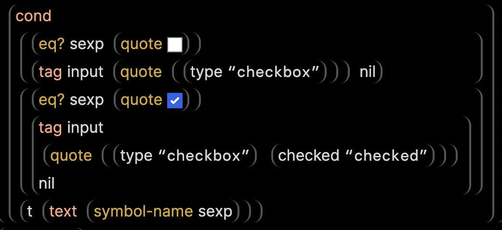
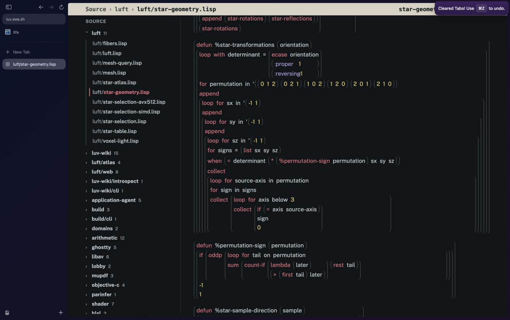
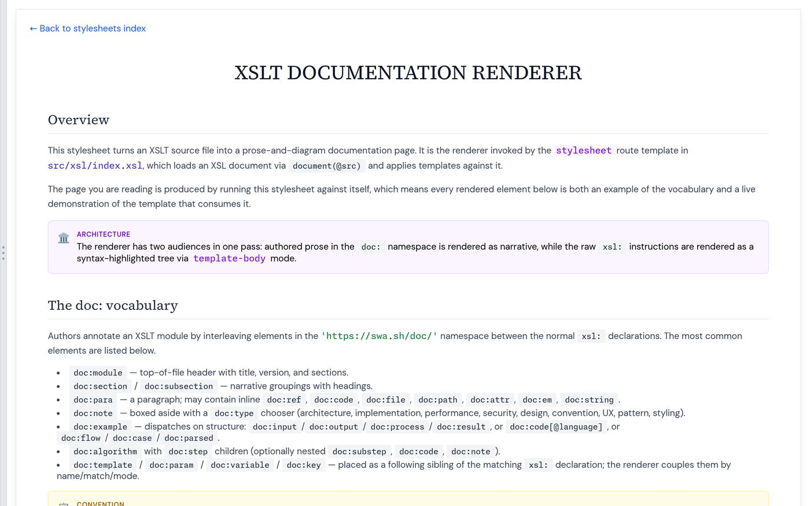
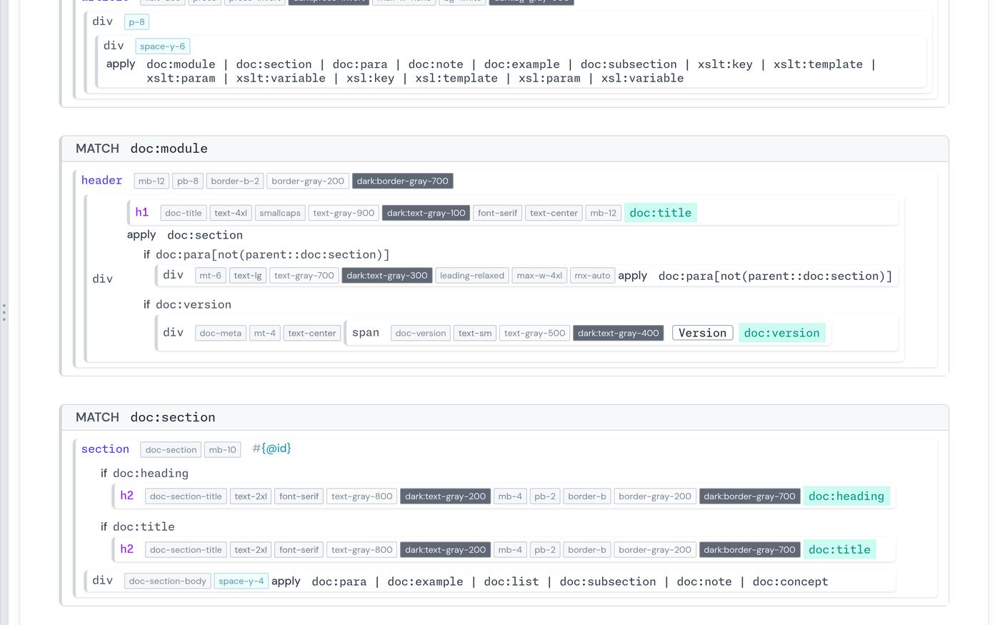
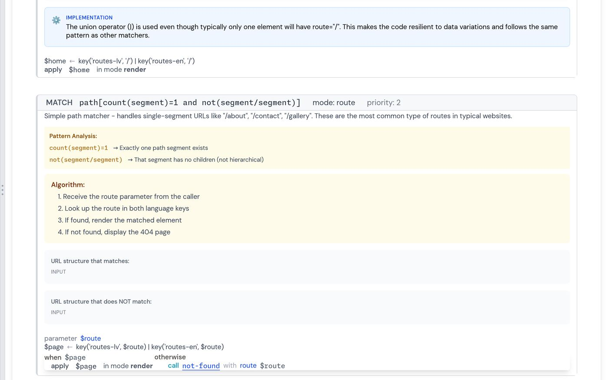
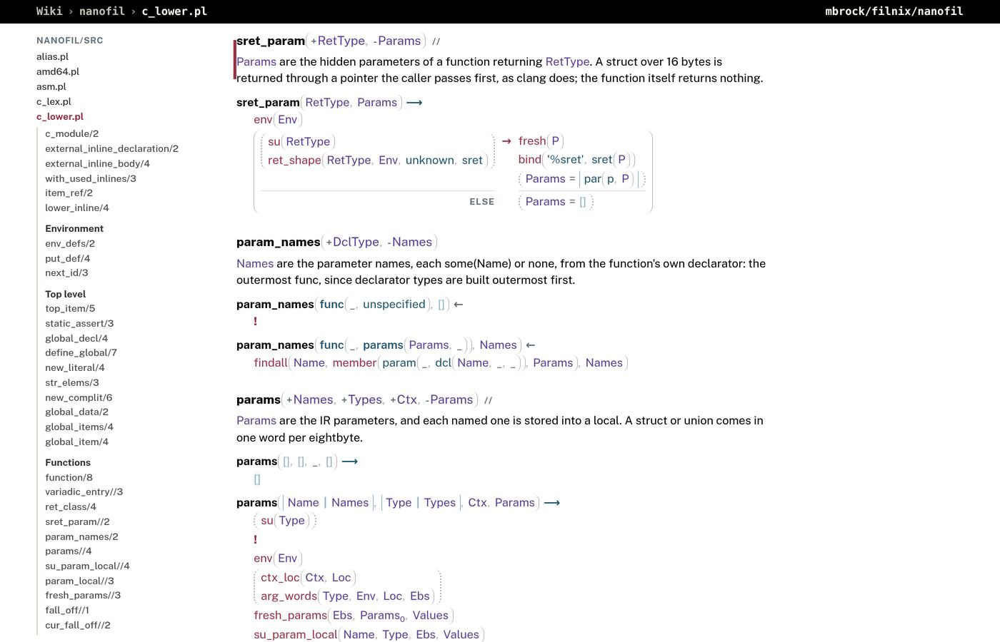
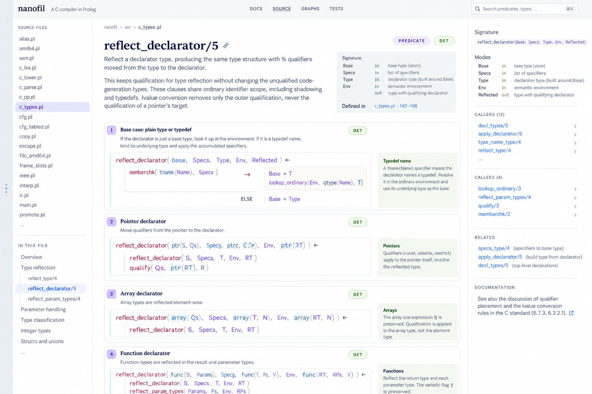
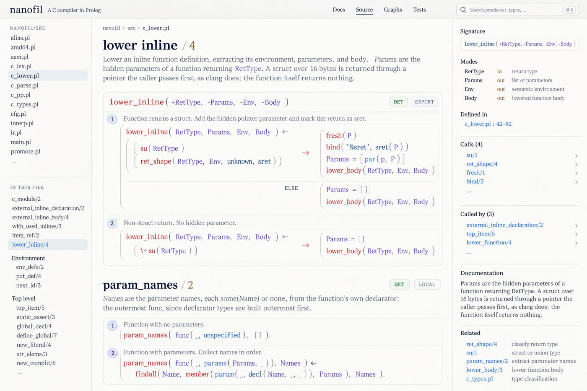
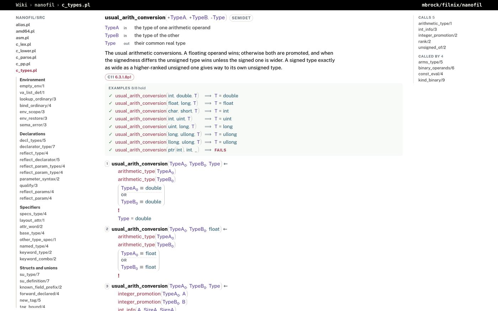

# dterm: nanofil's source as pages, and documentation as relations

dterm draws nanofil's Prolog as web pages
([web/dterm.pl](../web/dterm.pl), published with the Filnix wiki at
[mbrock.github.io/filnix/nanofil](https://mbrock.github.io/filnix/nanofil/)).
This file records where it comes from, what it does, and the change it
asks of how nanofil is written: **documentation is a relation of the
module, `doc/3`, and its examples are tests.**

## Lineage

dterm is the latest in a line of renderers that draw code as what it
is, not how it was typed.

**wisp's dexp** (mbrock/wisp) was the first: a structure editor for Lisp
in which every list is a box whose side borders are its parentheses.
Atoms are inline; boxes flow and wrap with the width, so the layout is
responsive without any line-breaking logic.



**luv's dexp** (mbrock/luv, `wiki/dexp.lisp`) took that to a whole wiki.
A small table of operator *layouts* (body forms stack, binding forms are
two-column grids, `cond` is a table of tests and bodies) assigns roles
in Lisp; the stylesheet only knows the roles. Lambda lists come from
introspecting the running image, and docstrings render as prose with
symbol references linked.



**bsd's xslt-doc** (mbrock/bsd, `src/base/xslt-doc.xsl`) went the other
way: it documented code with *structured data in the language itself*.
XSLT is XML, so documentation is elements in a `doc:` namespace between
the `xsl:` declarations: modules, sections, typed notes, algorithms,
examples with real XML input, and *pattern analysis* that explains each
predicate of a match. The processor ignores the `doc:` elements when it
runs the stylesheet; the renderer reads them like any other node. The
renderer documents itself with the vocabulary it renders. Its weakness
showed later: the richest documentation (routing.xsl's 257 `doc:`
elements) was dropped as the code moved on, because nothing checked it.





**dterm v1** (October 2026) was dexp for Prolog, written in Prolog: a
compound is its functor and a parenthesis box, a clause is its head over
one goal per row, if-then-else chains are tables, a predicate of short
facts is a table, PlDoc comments become signatures. It inferred all its
structure from the code and the comments.



**Two mockups** (made with ChatGPT from v1 screenshots) pointed where to
go next. The first gave a predicate a title, numbered its clauses as
cases each with a caption, put an argument table beside the signature,
and a panel of callers, callees and related predicates. The second, asked
to attend to typography, nestled punctuation: commas hugging their
arguments, parentheses close to their contents, quieter brackets.




## What we took

From dexp: *drawing is structure*. A box per compound, flow and wrap,
roles assigned in code and styled by CSS. No pretty-printer, no line
breaking.

From xslt-doc: *documentation in the language's own data model*. Prolog
has the same advantage XSLT does, and more: code is terms, so
documentation can be terms, read by `read_term/2` with everything else
and, unlike XML, *run*.

From xslt-doc's decline: *documentation that is not checked rots*.
So examples are goals, and a failing example fails the build.

From the mockups: numbered clauses, an argument table, cross references
beside the predicate, and tighter punctuation.

## doc/3

A documented module declares `:- discontiguous(doc/3).` and states, just
before each predicate:

```prolog
doc(usual_arith_conversion(+TypeA, +TypeB, -Type), semidet, [
    TypeA: "the type of one arithmetic operand",
    TypeB: "the type of the other",
    Type: "their common real type",
    "The usual arithmetic conversions. A floating operand wins; otherwise",
    "both are promoted, and when the signedness differs the unsigned type",
    "wins unless the signed one is wider. A signed type exactly as wide",
    "as a higher-ranked unsigned one gives way to its own unsigned type.",
    cites('C11 6.3.1.8p1'),
    example(usual_arith_conversion(int, uint, T), T = uint),
    example(usual_arith_conversion(llong, ulong, T), T = ullong),
    fails(usual_arith_conversion(ptr(int), int, _))
]).
```

- The head is the predicate's head with PlDoc modes `+ - ? @ :`. Write
  `?(X)` rather than `?X`: SWI and Trealla disagree on `?` as a prefix
  operator, and the canonical form reads the same on both. A DCG
  nonterminal is documented by its head without the two list arguments;
  dterm matches it to the `-->` clauses that follow.
- The second argument is the determinism: `det`, `semidet`, `nondet`,
  `multi`. `also(Head, Det)` adds another mode.
- `Var: "text"` describes an argument.
- Consecutive strings are one paragraph. Quoted text cannot span lines
  on Trealla, and SWI warns about `\` continuations followed by
  indentation, so write one string per line.
- `cites('C11 6.3.1.8p1')` cites a paragraph of the standard; dterm links
  it to N1570. It is the campaign's index from clause to predicate
  ([campaign.md](campaign.md), Visions).
- `example(Goal)` holds when Goal succeeds, `example(Goal, Check)` when
  Goal succeeds and then Check does, `fails(Goal)` when Goal fails.
  Goals run in the documenting module.

The facts are ordinary clauses of the module: no operator declarations,
no runtime cost beyond a few kilobytes of facts, and the same on both
hosts. Nothing calls `doc/3` but the tests and dterm.

### Examples are tests

`tests/unit.pl`'s `doc_examples` test runs every example of every module
listed in `documented_module/1` on both hosts, as part of
`nix build .#checks.x86_64-linux.nanofil`. dterm runs them again when it
builds the pages and marks each ✓ or ✗, so a page shows whether it was
true at its revision.

Planting `SizeA >= SizeB` in `usual_arith_conversion/3` (signed `llong`
wins over `ulong`) fails the unit test with

```
  c_types: example(usual_arith_conversion(llong,ulong,_),_=ullong) does not hold
FAILED doc_examples
```

and the page shows it:


## dterm v2



- `doc/3` facts render as the signature with its determinism badge, the
  argument table (name, in or out, description), the prose with argument
  names marked, citation chips, and the examples with their results.
- A predicate with several clauses numbers them, as cases of one
  definition; a comment before a clause is its caption.
- Each predicate lists the corpus predicates it calls and those that
  call it, from a call graph built over every clause body (meta-calls
  such as `maplist/N`, `findall/3` and `phrase/2,3` included). On wide
  screens they sit beside the predicate.
- Commas and parentheses sit closer to what they belong to.
- dterm loads the documented modules on SWI through `src/swi/compat.pl`,
  exactly as `bin/nanofil` does, to run the examples. Other modules are
  only read.

## Terms as type (October 2026)

v2 drew every compound as a flex box whose arguments were items. That
gave the right nesting but the wrong typography: the gap after a comma
was a flex gap, so a comma floated halfway between its arguments; a line
could break anywhere between items, even between a functor's box and its
neck; every paren box was as tall as its line, so `tmp(v0)` in a run of
IR had a frame round it heavier than the name it held; brackets looked
like parentheses; and a long term wrapped wherever the width ran out, so
C syntax became a staircase of nested frames.

dterm now sets terms as text, after the conventions of mathematical
setting and of Lisp's pretty-printers:

- A compound is its functor and an inline box whose side borders are its
  parentheses. Inline, the line breaks it as it breaks a parenthesis in
  prose: the opening one stays with the functor, the closing one with
  the last argument.
- A comma is text followed by a real space, so it hugs what it ends, the
  line may break after it, and justification and word spacing treat it
  as type. Wide operators (`=`, `≡`, `→`, `is`) have a no-break space
  before and a space after: a line breaks after an operator, never before
  it. The neck `←` stays on the head's line.
- Parentheses are hairlines that bow like the glyph (`--paren-stroke`
  0.1em, `--paren-curve` 0.3em) at 34% ink, a little off what they hold
  (0.19em) and their functor (0.07em), so a name never touches its bow. A box with boxes inside stands
  0.06em taller per level, three levels deep, as outer delimiters are
  set larger in mathematics, so `f(g(x))` shows its nesting without
  heavier lines.
- Brackets are square, with short arms, at 60% of the atom blue; a list
  never reads as a call. A tail bar `|` sits with its tail, 0.1em each
  side.
- Commas are at 52% ink: quieter than the names, firmer than v2's 30%,
  which disappeared against Public Sans's light punctuation.
- A head or goal too long for its line hangs its continuation lines
  1.5em under the first.
- Without JavaScript a term flows and wraps as text; on a narrow screen a
  conditional is a column. Where its lines break is dterm.js's printer.

### The printer

dterm.pl decides what a term is; `dterm.js` decides where its lines
break, at the width the page actually gives each head and goal. It is
Bernardy's printer ("A Pretty But Not Greedy Printer", ICFP 2017), cut
to dterm, after a first attempt in the style of
[Zoot](https://github.com/mbrock/zoot) and the pretty expressive printer
that filled lines as prose and broke deep inside small terms.

dterm.pl marks the groups: `data-d=args` on a compound or list, whose
`.arg` children are its items, and `data-d=op` on an operator a line
may break at. The printer reads each head and goal as a document in
Bernardy's operators (text, `<>` with its later lines aligned where it
began, `flush`, and choice), measured in pixels with canvas. The craft
is in which layouts each group offers:

- arguments: all on one line; the first, and simple ones after it, on
  the opening line and each of the rest on its own line, aligned under
  the first or hung `--indent` past the term; or, as Lisp is set, all
  from the next line, a step past the functor, so a deep C syntax tree
  comes back left. Simple arguments fill their lines instead; a list of
  compound terms (instructions) is one line only within half the ribbon.
- a chain of one operator: one line, or a line per operand. A comma ends
  its line; `→` and `;` start theirs, under the condition, as Prolog is
  written.
- a group on one line has all of it on that line.

Each document gets its Pareto frontier by height, width, last-line width
and badness (a hung or Lisp layout is a little worse than an aligned
one), computed once per piece since a layout's measures do not depend on
where it starts. A layout wider than the width, or a single line longer
than `--ribbon` (34em: how much one line may hold however wide the
page), is dropped when it is made. The printer takes the fewest lines,
then the least bad; if nothing fits it lets the ribbon go, then the
width.

A conditional is a table only while it fits and every branch is one
goal; otherwise it is a stack whose IF, THEN and ELSE share one column,
so every branch starts at the same place.

The plan is written as kpre (`mbrock/kpre`) writes a paragraph: a break
is a `<br class="zbr">` and an indent, every other separator a no-break
space, so the browser draws exactly the plan. `html[data-planner=off]`
shows the text unbroken; the workbench's *Line breaks* knob compares the
two, and its *ribbon* and *hang* knobs tune the printer.

The [workbench](https://mbrock.github.io/filnix/nanofil/workbench/)
(`web/workbench/`) sets representative terms twice, under presets or
any knob (paren ink, stroke, bow and spacing, bracket style, comma ink
and weight, operator spacing, the ribbon and hang, v2's layout), at phone,
tablet or half-window width. The values above were chosen there against
v2, quieter and firmer ink, glyph parentheses, and the looser spacing of
the second mockup: glyph parentheses in Public Sans are tall and light
and do not nest visibly; looser spacing pulls commas away from what they
end; quieter ink loses the nesting in IR.

## Praxis

nanofil's AGENTS.md now asks, for modules listed in
`documented_module/1`:

- A new or changed exported predicate gets a `doc/3` fact with at least
  one example, and each case of its behaviour an example: both sides of
  a boundary, the failing case, and asymmetric inputs where an
  implementation could confuse its arguments.
- Expected values come from the standard or by hand, not from running
  the code: the examples are how the documentation and the code check
  each other.
- A `%!` comment that a `doc/3` fact replaces is removed; the same fact
  is not said twice.
- `cites/1` names the paragraph a rule implements, where there is one.

`c_types.pl`'s Integers section was the first converted. Its typing
rules followed: compatible and composite types (6.2.7), the typed tree
(`elaborate/3`), lvalues and value conversion (6.3.2.1), and the
operators, casts, assignment and `?:` (6.5). Together they are 34
predicates with 121 examples. Writing them as documents also flattened
nested conditionals into named relations such as `composite_size/3`,
`identifier_type/4`, `designator/3` and `pointed_type/4`, and wrote
`->` as `elab(member(un(deref, E), F))`, as 6.5.2.3p4 defines it.

## Module headers as prose (October 2026)

A file's header comment is the lede of its page, and it had been
written for an 80-column terminal: term grammars as aligned columns,
fields as indented runs, all drawn as one grey preformatted block. The
comment now takes a little Markdown, chosen so the plain text still
reads well in an editor:

- `## Heading` and `### Heading`, drawn as h3 and h4 (the page's own
  sections are h2);
- pipe tables, `| A | B |` over `|---|---|`, where a `|` inside
  backticks stays in its cell;
- ```` ```prolog ```` fences, whose terms (each ending in a full stop)
  are drawn as terms, and ```` ```diagram ```` fences for a box drawing;
- inline code that reads as a compound term, such as `ptr(T)` or
  `e(Ords, Tags, Defs, Next)`, set as a term in the colours of the code;
  `Name/Arity` and anything that does not read stays code.

Indented lines are still a preformatted block, so an unconverted header
draws as before. `c_types.pl` was converted first, its type terms, the
environment and its definitions and members each a table; the other
modules followed.

## Not yet

- Captions as data (`case/2` in `doc/3`, naming the clauses), so a
  predicate's cases are stated, not inferred from comments.
- Pattern analysis in xslt-doc's sense: what each clause head requires
  of its arguments, derived from the head.
- Relations that run backwards in their examples, `int_type(T)`
  enumerating, shown as tables of their answers.
- A dark scheme, search, and the mockups' "related" list.
